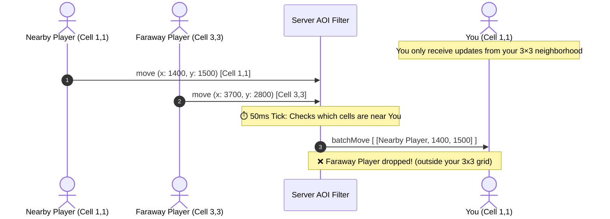

**In short:**
Instead of sending every player's movement to _everyone_ across the entire map, we split the world into a grid of cells. You only receive movement updates for players inside your cell and the 8 neighbor cells around you (a 3×3 area).

---

### The Example

Suppose **500 players** are active on the map:

- **Without AOI**:
  - Every 50ms tick sends all 500 players to your browser.
  - In 1 second: $500 \text{ players} \times 20 \text{ ticks} = \mathbf{10,000} \text{ updates/sec}$ sent to your client!
  - Your browser wastes CPU parsing and moving players who are on the other side of town where you can't even see them.

- **With AOI (3×3 Grid)**:
  - If only **20 players** are near you in your 3×3 neighborhood, the server sends **only those 20 players**.
  - In 1 second: $20 \text{ players} \times 20 \text{ ticks} = \mathbf{400} \text{ updates/sec}$.
  - The other **480 players** are completely dropped by the server for your client until you walk closer to them.

---

### The 3×3 Grid Visual

```text
 ┌─────────┬─────────┬─────────┐   ┌─────────┐
 │  (0,0)  │  (1,0)  │  (2,0)  │   │  (3,0)  │
 ├─────────┼─────────┼─────────┤   ├─────────┤
 │  (0,1)  │   YOU   │  (2,1)  │   │  (3,1)  │  <-- Faraway players here
 ├─────────┼─────────┼─────────┤   ├─────────┤      are culled (ignored)
 │  (0,2)  │  (1,2)  │  (2,2)  │   │  (3,2)  │
 └─────────┴─────────┴─────────┘   └─────────┘
  <-- Your 3×3 Visible Area -->
```

---

### How It Works


