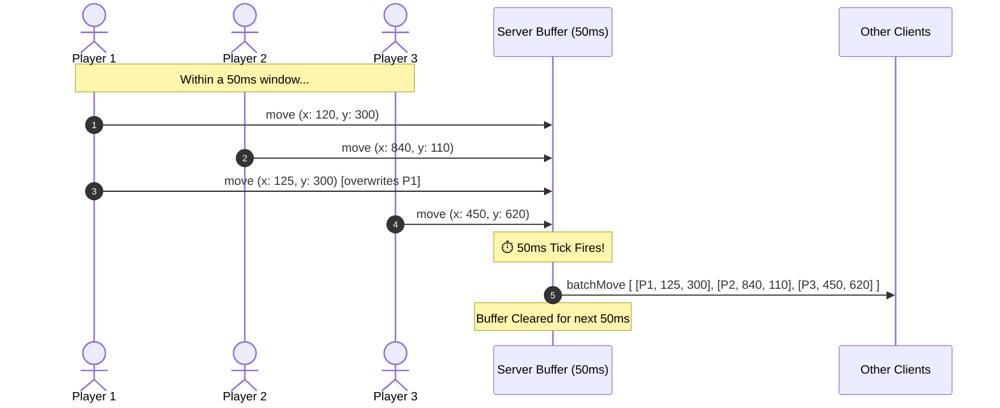

in short, instead of broadcasting each player's move individually and multiple time, we will collect all the changes/udpates for 50ms and then broadcase them all at the same time as single broadcast message.

ex: if 10 players are moving, for 1 second. it would broadcase 200 event each player per second \* 10 = 2000 payloads in socket!
but instead of that we will collect all the messages for 50ms and broadcasting them will results as, only 20 broadcast payloads per second in total, regardless of how many players are moving.

